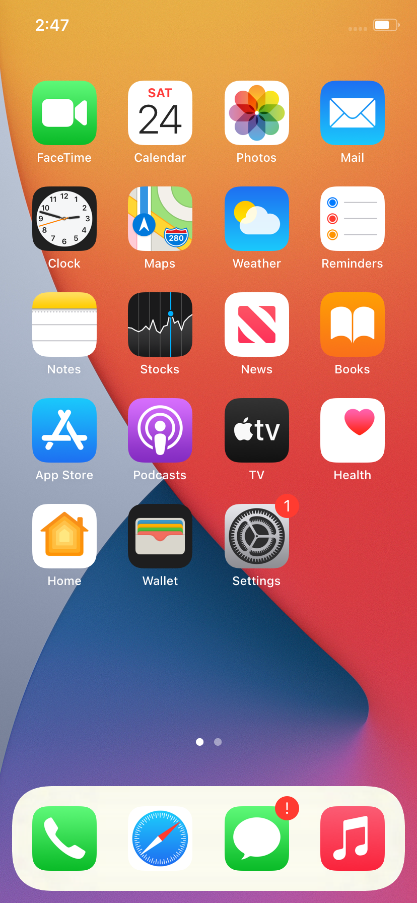

# iPhone 11 (t8030) running iOS 14 on ChefKiss Inferno, from a Linux host

**Status (2026-10-24):** iOS 14.0 beta 5 (18A5351d) gets to the **SpringBoard home screen**, with touch (the mouse),
the hardware buttons (F-keys) and the stock apps working. The emulator is [ChefKissInc/Inferno](https://github.com/ChefKissInc/Inferno)
`master` @ cc4302a991 (formerly QEMUAppleSilicon), using a real emulated SEP. Rendering is in software, and a boot takes about 2.5 minutes.

Follow the **official guide** (chefkiss.dev → AppleHax → Inferno) for setup. As that guide asks, this repo ships **no firmware,
keys, images or setup automation**, only a launcher and the Linux-host notes below.

## Linux-host notes and fixes (things the guide doesn't cover)
- **Build:** use gcc. A clang/aocc linker can't read an LTO-built `liblzfse.a`. Run `git submodule update --init` (the `util/mlib` submodule is required).
- **Keep debug info** (`-Ddebug=true`): the guide's `--disable-debug-info` sets `-DNDEBUG`, and Inferno's `assert_cmp*`
  macros then compile out code that has side effects. The restore then panics with *"SEP returned zero-length ART"*.
- **Headless runs: use `-display egl-headless`, not `-display none`.** With no display the frame-done event never fires,
  so the restore sits at "ASR 4%" forever.
- **Simulated SEP isn't enough to boot:** the restore works, but the first boot loops on keystore requests (Copy Keybag /
  Change Lock State; several requests are unimplemented, see upstream issue #52) and sits on the Apple logo. Use the real-SEP setup from the guide.
- **Companion VM:** start usbmuxd only *after* the iPhone has appeared on USB (starting it early wedged restore-mode detection).
  Running usbmuxd as root (`-U root`) avoids needing a `usbmux` user. Give the companion 8 GB of RAM.
- **Filesystem patches without macOS** are possible (in-place, same-size edits of the dyld cache patch sites and the
  launchd.plist `Disabled` flags, verified by reading them back). Adding *new* files (e.g. the bash/apt bootstrap) needs a
  read-write APFS driver ([linux-apfs-rw](https://github.com/linux-apfs/linux-apfs-rw)). **Never `cp -a` existing iOS
  files on the mounted volume**: compressed files carry xattrs that corrupt the copy's record.
- **ntfs3 hosts:** ntfs3 rejects symlink targets that end in `/`, so a couple of source-tree symlinks need creating by hand.
  qcow2 behaved better than raw for the root disk there.
- **Buttons:** the first couple of key presses after boot are ignored (upstream #247), so tap F3 or F4 once first.
  F6 = Home (twice = app switcher), F5 = side button. If the "Swipe up" setup screen won't respond: SOS (hold F4, then
  F5), slide to power off, then boot again.

## Never
Never set a passcode, turn on Location Services, or use "Erase All Content and Settings" (the last one bricks the install).

## Files
- `run-iphone.sh`: launcher (GTK window `zoom-to-fit=on,show-cursor=on`; `--headless`; `--companion`). Expects the
  guide's data folder as `data/`, the build in `src/build/`, and your own `vm-args.sh`.
- `vm-args.sh`: the run arguments used here (real SEP; the file paths point at your own local files).
