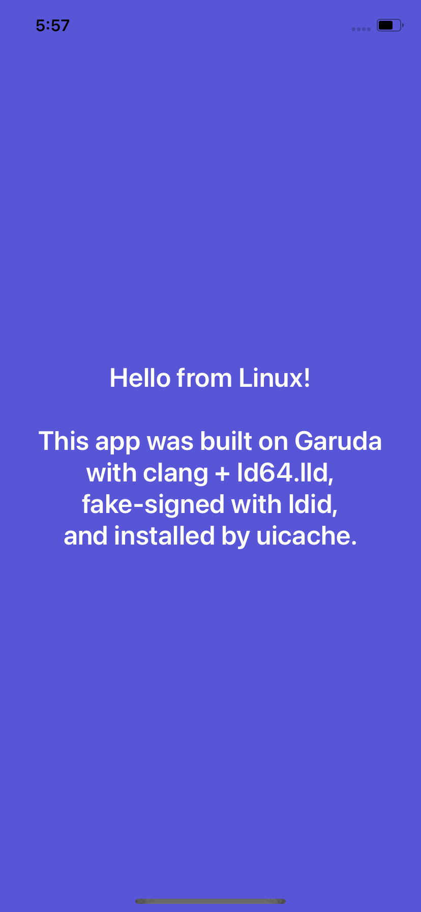

# iPhone 11 (t8030) running iOS 14 on ChefKiss Inferno, from a Linux host

**Status (2026-10-24):** iOS 14.0 beta 5 (18A5351d) gets to the **SpringBoard home screen**, with touch (the mouse),
the hardware buttons (F-keys) and the stock apps working. There's also a **root bash shell, internet via reverse tethering, apt,
and a self-built app installed and running**. The emulator is [ChefKissInc/Inferno](https://github.com/ChefKissInc/Inferno)
`master` @ cc4302a991 (formerly QEMUAppleSilicon), using a real emulated SEP. Rendering is in software, and a boot takes about 2.5 minutes.

Follow the **official guide** (chefkiss.dev → AppleHax → Inferno) for setup. As that guide asks, this repo ships **no firmware,
keys, images or setup automation**, only a launcher and the Linux-host notes below.

## Linux-host notes and fixes (things the guide doesn't cover)
- **Build:** use gcc. A clang/aocc linker can't read an LTO-built `liblzfse.a`. Run `git submodule update --init` (the `util/mlib` submodule is required).
- **Keep debug info** (`-Ddebug=true`): the guide's `--disable-debug-info` sets `-DNDEBUG`, and Inferno's `assert_cmp*`
  macros then compile out code that has side effects. The restore then panics with *"SEP returned zero-length ART"*.
- **Headless runs: use `-display egl-headless`, not `-display none`.** With no display the frame-done event never fires,
  so the restore sits at "ASR 4%" forever.
- **Simulated SEP isn't enough to boot:** the restore works, but the first boot loops on keystore requests (Copy Keybag /
  Change Lock State; several requests are unimplemented, see upstream issue #52) and sits on the Apple logo. Use the real-SEP setup from the guide.
- **Companion VM:** start usbmuxd only *after* the iPhone has appeared on USB (starting it early wedged restore-mode detection).
  Running usbmuxd as root (`-U root`) avoids needing a `usbmux` user. Give the companion 8 GB of RAM.
- **Filesystem patches without macOS** are possible (in-place, same-size edits of the dyld cache patch sites and the
  launchd.plist `Disabled` flags, verified by reading them back). Adding *new* files (e.g. the bash/apt bootstrap) needs a
  read-write APFS driver ([linux-apfs-rw](https://github.com/linux-apfs/linux-apfs-rw)). **Never `cp -a` existing iOS
  files on the mounted volume**: compressed files carry xattrs that corrupt the copy's record.
- **ntfs3 hosts:** ntfs3 rejects symlink targets that end in `/`, so a couple of source-tree symlinks need creating by hand.
  qcow2 behaved better than raw for the root disk there.
- **Buttons:** the first couple of key presses after boot are ignored (upstream #247), so tap F3 or F4 once first.
  F6 or middle click (with the patch) = Home (twice = app switcher), F5 = side button. If the "Swipe up" setup screen won't respond: SOS (hold F4, then
  F5), slide to power off, then boot again.

## Never
Never set a passcode, turn on Location Services, or use "Erase All Content and Settings" (the last one bricks the install).

## Files
- `run-iphone.sh`: launcher. GTK window at `scale=0.65` with `zoom-to-fit=off` (about 1226 px tall, 85% of a 1440p
  screen), centred on the primary monitor with kdotool since Wayland apps can't place themselves; `--headless`;
  `--companion`. Expects the guide's data folder as `data/`, the build in `src/build/`, and your own `vm-args.sh`.
  With `zoom-to-fit=on` the window can't be made smaller than the 828x1792 screen, so it overflows a 1440p monitor.
  At 0.65 GTK shrinks with an averaging filter, so text stays clean (`screenshots/scale-065-text-compare.png`:
  full size / 0.65 GTK / 0.65 nearest-neighbour).
- `patches/0001-mt-spi-middle-click-home.patch`: makes the **middle mouse button a Home button** (sends F6; double click =
  app switcher; never sends a tap). Apply in the Inferno tree and rebuild. A left-edge "back" swipe isn't possible on this
  build, because iOS ignores screen-edge gestures here (upstream issue #53).
- `vm-args.sh`: the run arguments used here (real SEP; the file paths point at your own local files).
- `tools/set-boot-splash.sh`: swaps the picture Inferno shows before iOS starts for your own
  (`set-boot-splash.sh picture.png`, `--github <user>` for your GitHub avatar, `--restore` for the original).
  Fitted onto a black square, takes effect on the next boot, no rebuild. Inferno's `ui/icons/CKBrandingNotice.md`
  says their artwork is © ChefKiss and modified builds must drop it, so this also de-brands a local build.

## Root shell, internet, apt and app installs

- **Bootstrap:** the checkra1n core bootstrap (from the guide's Post-Setup page) was written onto the **System** volume from
  Linux with linux-apfs-rw. **Data was never mounted.** Plain apfsck can't parse the real-SEP keybag (an `0xF8` entry), so it isn't
  usable as a pass/fail check. The gate used instead: a full-check variant of apfsck had to report the **same complaint list
  before and after**, and the other volumes had to stay byte-identical, with a qcow2 snapshot ready to roll back to. Boot with
  `launchd_unsecure_cache=1` (the edited launchd.plist no longer matches its .sig).
- **Shell:** `bash-5.0#` on the serial console (use a socket chardev so it accepts input). Run `mount -uw /` before installing anything.
- **Reverse tethering**, entirely inside the companion VM: usbmuxd with `USBMUXD_DEFAULT_DEVICE_MODE=3`, a /24 on the
  iPhone's USB-ethernet interface, dnsmasq for DHCP/DNS, and nftables masquerade out of the companion's uplink. Pair with
  `idevicepair pair` and tap Trust.
- **apt:** after the strap's `/usr/libexec/firmware.sh` and `dpkg --configure -a`, the strap vendor's repo works
  (`apt install uikittools openssh`).
- **Apps:** the kernel patches already bypass code signing, so a **fake-signed** app (`ldid -S -I<bundle id>`) copied into
  `/Applications` and registered with `uicache -p` runs. `testapp/` is a tiny UIKit app written in C against the ObjC
  runtime, built on Linux with clang + ld64.lld and hand-written `.tbd` stubs, so **no Apple SDK** is needed (`testapp/build.sh`).
  `tools/install-app.sh` is the signing/serving/installing helper used here; it expects the local helper scripts
  (`comp-run.sh`, `tools/ios-sh.sh`), so treat it as a reference. Only install self-built or open-source apps.
